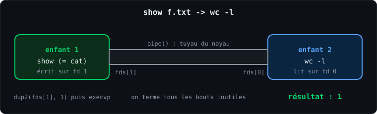

<div align="center">



<br/>


**Projet 3 · Systèmes d'Exploitation · UIR / ESIN**



[Lancer](#-lancer) · [Tester](#-tester-en-1-minute) · [Commandes](#-commandes) · [Fonctionnement](#-fonctionnement) · [Code](#-le-code)

</div>

---

## ✨ Présentation

**ocsh** est un interpréteur de commandes écrit en C, en appelant directement les appels système du noyau. Il lit une ligne, la découpe, puis lance les programmes demandés, avec ses propres noms de commandes (`list`, `show`, `go`…) et son propre opérateur de pipe : **`->`**.

<table>
<tr>
<td align="center">⚙️<br/><b>fork + exec</b><br/>lancement des programmes</td>
<td align="center">🔀<br/><b>dup2</b><br/>redirections <code>&gt;</code> <code>&gt;&gt;</code> <code>&lt;</code></td>
<td align="center">🔗<br/><b>pipe</b><br/>chaînage avec <code>-&gt;</code></td>
<td align="center">🚦<br/><b>signaux</b><br/>Ctrl+C, Ctrl+Z, SIGCHLD</td>
</tr>
<tr>
<td align="center">💲<br/><b>variables</b><br/><code>$NOM</code> <code>$?</code> <code>$!</code></td>
<td align="center">🧪<br/><b>substitution</b><br/><code>$(cmd)</code></td>
<td align="center">📜<br/><b>scripts</b><br/>if / for / while</td>
<td align="center">⭐<br/><b>jobs</b><br/>jobs · fg · bg</td>
</tr>
</table>

---

## 🚀 Lancer

Environnement : **Linux** avec `gcc` et `make` (sous Windows : Ubuntu / WSL).

```bash
sudo apt update && sudo apt install build-essential   # si gcc / make sont absents
git clone https://github.com/inasbsgt/OCSH.git
cd OCSH
make
./ocsh
```

Le prompt `ocsh>` s'affiche. Pour quitter : `quit` ou **Ctrl+D**.

| Usage | Commande |
|---|---|
| Mode interactif | `./ocsh` |
| Une seule commande | `./ocsh -c 'say bonjour'` |
| Exécuter un script | `./ocsh script.ocsh` |
| Lire depuis l'entrée standard | `echo "say salut" \| ./ocsh` |
| Compiler et lancer | `make run` |
| Nettoyer | `make clean` |

---

## 🧪 Tester en 1 minute

▶️ La [vidéo de démonstration](demo.mp4) présente ces fonctionnalités en action.

Dans ocsh, chaque ligne de la colonne « À taper » donne le résultat indiqué :

| Fonctionnalité | À taper | Résultat attendu |
|---|---|---|
| Redirection | `say hello > f.txt` puis `show f.txt` | `hello` |
| Ajout à un fichier | `say suite >> f.txt` puis `show < f.txt` | `hello` puis `suite` |
| Pipe | `show f.txt -> wc -l` | le nombre de lignes du fichier |
| Arrière-plan | `sleep 10 &` | `[1] PID`, la main revient tout de suite |
| Jobs | `jobs` | `[1] Running  sleep 10` |
| PID du dernier job | `say $!` | le PID affiché par `sleep 10 &` |
| Variable | `NOM=Ada` puis `say "$NOM"` | `Ada` |
| Statut | `false` puis `say $?` | `1` |
| Substitution | `say "$(path)"` | le dossier courant |
| Alias | `newdir essais` puis `list` | `essais` apparaît dans la liste |
| Changement de dossier | `go essais` puis `path` | le chemin se termine par `essais` |
| Texte imposé | `osinfo` | `Systèmes d’Exploitation -- UIR/ESIN` |

<details>
<summary>⏯️ <b>Job control : Ctrl+Z, bg, fg</b></summary>

```text
ocsh> sleep 30
^Z
[1]+ Stopped   sleep 30
ocsh> jobs
[1] Stopped  sleep 30
ocsh> bg
[1] sleep 30 &
ocsh> fg
sleep 30
^C
ocsh>
```

Le numéro `[1]` suppose qu'aucun autre job n'est en cours ; sinon c'est `[2]`, `[3]`…

`Ctrl+Z` met en pause · `bg` relance en arrière-plan · `fg` ramène au premier plan · `Ctrl+C` arrête la commande sans fermer le shell.

</details>

---

## 📚 Commandes

Chaque commande Bash a son équivalent dans ocsh :

<div align="center">

</div>

🟢 **builtin** : exécuté par ocsh lui-même &nbsp;·&nbsp; 🔵 **alias** : vrai programme Linux lancé sous un autre nom (options et arguments transmis) &nbsp;·&nbsp; 🟣 **opérateur**

| | Bash | **ocsh** | Effet |
|:---:|:---:|:---:|---|
| 🟢 | `cd` | **`go [dossier]`** | change de dossier (sans argument : `$HOME`) |
| 🟢 | `exit` | **`quit [code]`** | quitte le shell |
| 🟢 | `pwd` | **`path`** | affiche le dossier courant |
| 🟢 | `echo` | **`say texte`** | affiche du texte |
| 🟢 | `help` | **`info`** | affiche l'aide |
| 🟢 | `history` | **`past`** | affiche l'historique |
| 🟢 | `export` | **`export NOM`** | rend une variable visible des programmes lancés |
| 🟢 | `jobs` · `fg` · `bg` | **`jobs`** · **`fg`** · **`bg`** | gèrent les tâches (mêmes noms que dans Bash) |
| 🟢 | – | **`osinfo`** | affiche `Systèmes d’Exploitation -- UIR/ESIN` |
| 🔵 | `ls` | **`list`** | liste les fichiers |
| 🔵 | `cat` | **`show`** | affiche le contenu d'un fichier |
| 🔵 | `cp` | **`copy`** | copie un fichier |
| 🔵 | `mv` | **`move`** | déplace ou renomme |
| 🔵 | `rm` | **`del`** | supprime |
| 🔵 | `mkdir` | **`newdir`** | crée un dossier |
| 🔵 | `touch` | **`newfile`** | crée un fichier vide ou met à jour ses dates |
| 🟣 | `\|` | **`->`** | pipe : la sortie de gauche devient l'entrée de droite |

Tous les autres programmes Linux (`wc`, `ps`, `sleep`, `grep`…) restent utilisables tels quels.

### Syntaxe

| Symbole | Sens | Exemple |
|---|---|---|
| `->` | pipe | `show f.txt -> wc -l` |
| `>` · `>>` · `<` | écraser · ajouter · lire | `say hi >> f.txt` |
| `&` | arrière-plan | `sleep 10 &` |
| `;` | enchaîner | `say a ; say b` |
| `"…"` · `'…'` | guillemets (`'…'` bloque l'expansion des `$`) | `say "$NOM"` |
| `#` | commentaire | `# note` |
| `$NOM` · `${NOM}` · `$?` · `$!` · `$$` | variables | `say $?` |
| `$(cmd)` · `` `cmd` `` | substitution de commande | `say "$(path)"` |

### Scripts

Un script est un fichier texte qui contient des commandes ocsh. `./ocsh script.ocsh` les exécute l'une après l'autre, comme un script Bash. Avec `for`, `while` et `if`, un script peut **répéter** des actions ou **choisir** selon une condition :

| Construction | Rôle | Exemple |
|---|---|---|
| `for` | répète pour chaque valeur d'une liste | `for nom in Ada Linus; do say "Bonjour $nom"; done` |
| `while` | répète tant que la condition est vraie | `while [ "$i" -lt 3 ]; do …; done` |
| `if` | choisit selon une condition | `if [ "$i" -eq 3 ]; then …; else …; fi` |

Une condition est une commande : si elle réussit (code 0), elle est vraie.

<details>
<summary>📜 <b>Exemple complet</b></summary>

Fichier `script.ocsh` :

```text
for nom in Ada Linus; do
    say "Bonjour $nom"
done

i=0
while [ "$i" -lt 3 ]; do
    say "Tour $i"
    i=$(expr "$i" + 1)
done

if [ "$i" -eq 3 ]; then
    say termine
else
    say erreur
fi
```

Exécution : `./ocsh script.ocsh`
Sortie : `Bonjour Ada`, `Bonjour Linus`, `Tour 0`, `Tour 1`, `Tour 2`, `termine`.

</details>

### Saisie

| Touche | Effet |
|---|---|
| **Tab** | complète les commandes et les fichiers |
| **↑ ↓** | parcourt l'historique (sauvegardé dans `~/.ocsh_history`) |
| **← →** | déplace le curseur |
| **Ctrl+C** | arrête la commande en cours ; le shell reste ouvert |
| **Ctrl+Z** | met la commande en pause |
| **Ctrl+D** | quitte (ligne vide) |
| `...>` | invite affichée quand un `if` / `for` / `while` n'est pas terminé |

Le fichier `~/.ocshrc` est exécuté au démarrage en mode interactif.

---

## 🧩 Fonctionnement

| Étape | Ce que fait ocsh | Appel système |
|---|---|---|
| Lecture | lit la ligne touche par touche | `read`, `tcsetattr` |
| Création | crée un processus enfant par commande | **`fork()`** |
| Exécution | l'enfant devient le programme demandé | **`execvp()`** |
| Attente | le parent récupère le code de retour | **`waitpid()`** |
| Pipe `->` | relie la sortie d'une commande à l'entrée de la suivante | **`pipe()`** + `dup2()` |
| Redirection | branche l'entrée ou la sortie sur un fichier | `open()` + **`dup2()`** |
| Ctrl+C | interrompt la commande, pas le shell | **`SIGINT`** |

### fork → exec → wait

<div align="center">

</div>

### Le pipe

<div align="center">

</div>

---

## 📂 Le code

Tout le code est dans **`code/ocsh.c`**, en deux parties.

| Section | Contenu | Fonctions principales |
|---|---|---|
| **1.A** | alias et builtins | `resolve_alias`, `is_builtin` |
| **1.B** | analyse d'une commande | `parse_word`, `parse_command`, `split_pipeline` |
| **1.C** | redirections | `apply_redirs` |
| **1.D** | builtins | `run_builtin` |
| **1.E** | signaux | `on_sigint`, `on_sigchld`, `signals_setup` |
| **1.F** | attente et jobs | `wait_group`, `job_fg`, `job_bg` |
| **1.G** | lancement | `run_child`, `launch_pipeline` |
| **1.H** | une instruction | `exec_statement` |
| **2.A** | variables | `var_set`, `var_get` |
| **2.B** | `$(...)` | `command_subst` |
| **2.C** | expansion | `expand` |
| **2.D** | historique | `history_add`, `history_load`, `history_save` |
| **2.E** | clavier | `read_line`, `complete` |
| **2.F** | `if` / `for` / `while` | `split_statements`, `exec_range` |
| **2.G** | boucle principale | `interactive_loop`, `main` |

---

## 📦 Contenu du dépôt

```text
OCSH/
├── code/ocsh.c      tout le code C commenté
├── Makefile         make · make run · make clean
├── README.md        ce fichier
├── report.pdf       rapport
├── demo.mp4         vidéo de démonstration
└── assets/          animations du README
    ├── banner.svg
    ├── demo.svg
    ├── equiv.svg
    ├── fork.svg
    └── pipe.svg
```

---

## 👥 Équipe

| Membre | GitHub |
|---|---|
| Inas Basguit | [inasbsgt](https://github.com/inasbsgt) |
| Ahmed Al-aabqary | [Y0kina](https://github.com/Y0kina) |
| Sami Goumi | [akoulaaaaaaaa](https://github.com/akoulaaaaaaaa) |
| Yasmine El baijouni | [still loading…](https://www.youtube-nocookie.com/embed/dQw4w9WgXcQ?autoplay=1) |

<div align="center">

<sub>Systèmes d'Exploitation · UIR / ESIN</sub>

</div>
